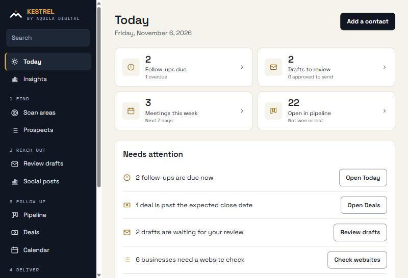
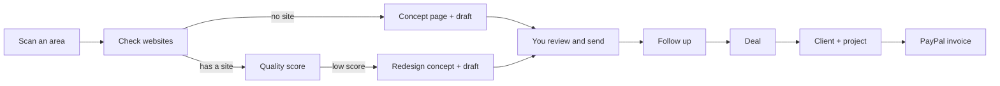
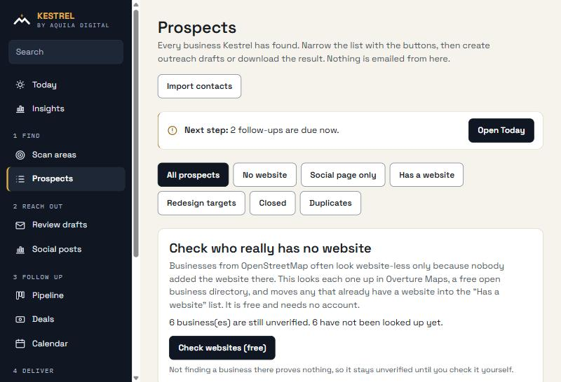
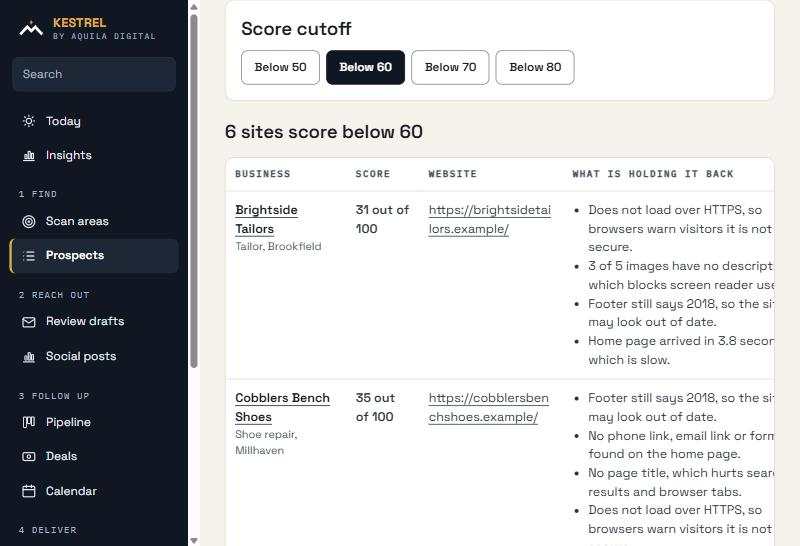
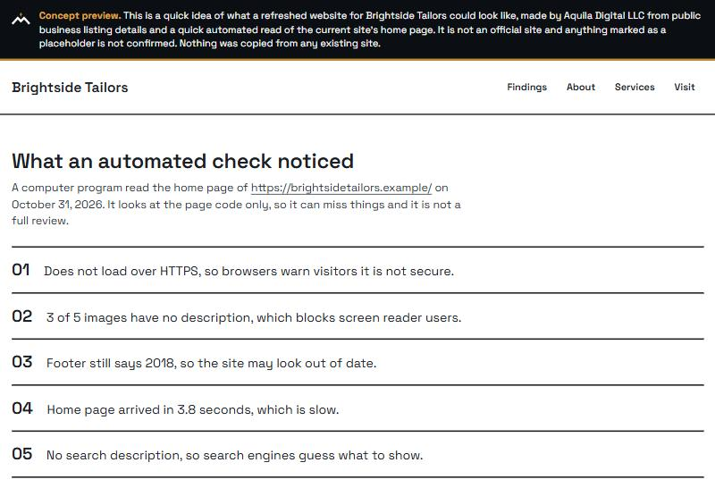
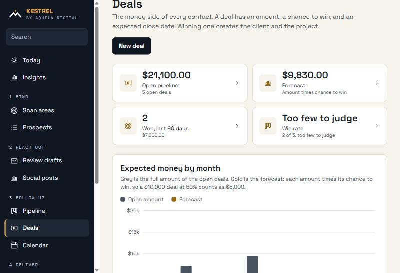
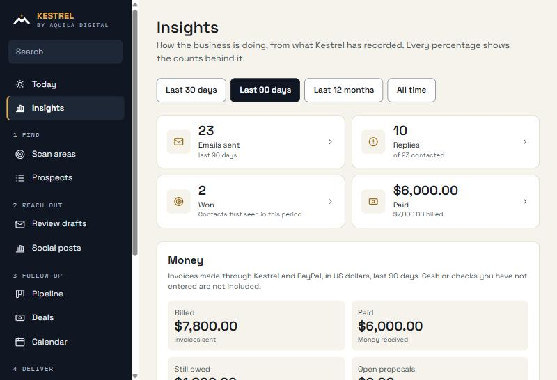

<div align="center">

# Kestrel

**Find local businesses that need a better website, show them an honest concept, and run the sale from first contact to paid invoice.**

An internal tool by [Aquila Digital LLC](https://www.aquiladigital.net)




</div>

## What it does

| | |
|---|---|
| **Find** | Scans an area on free OpenStreetMap data for local businesses, no paid API. |
| **Verify** | Checks each "no website" lead against free Overture Maps data so you never pitch a business that already has a site. |
| **Score** | Audits existing sites for HTTPS, speed, accessibility, freshness and contact options, then lists the weakest as redesign targets. |
| **Show** | Builds a concept page for each target, clearly labelled as a concept, built from public listing details and the audit findings. |
| **Reach out** | Writes outreach drafts for you to review. **Nothing is ever emailed automatically**; sending is a manual click behind hard guardrails (daily cap, do-not-contact list, unsubscribe link). |
| **Run the sale** | Pipeline, deals with a probability weighted forecast, tasks, calendar, clients, projects and PayPal invoices. |
| **Learn** | Insights show replies, wins and money, and every percentage carries its counts so small samples are not dressed up as trends. |
| **Stay safe** | Encrypted backups, per-contact export and delete, duplicate merge, CSV import, tags, saved views and bulk actions. |
| **Post** | A separate Social module drafts and schedules posts for your apps, with an approval gate. |

## How a lead moves through it



## See it

All screenshots use a fictional demo dataset. No real people or businesses appear.

<table>
  <tr>
    <td width="50%"><br><sub><b>Prospects.</b> Filter by website status, redesign need and duplicates.</sub></td>
    <td width="50%"><br><sub><b>Redesign targets.</b> Weakest sites first, with the plain reasons why.</sub></td>
  </tr>
  <tr>
    <td width="50%"><br><sub><b>Concept page.</b> Honestly labelled, and it states what the automated check found.</sub></td>
    <td width="50%"><br><sub><b>Deals.</b> Open pipeline, forecast and expected money by month.</sub></td>
  </tr>
  <tr>
    <td colspan="2"><br><sub><b>Insights.</b> Emails, replies, wins and money, each with the counts behind it.</sub></td>
  </tr>
</table>

## Principles

- **Free to run.** OpenStreetMap, Overture Maps and the built-in audit cost nothing. Paid services (Google Places, AI writing help) are optional and off by default.
- **Honest by design.** Concept pages say they are concepts, never copy a site, and mark anything unconfirmed as a placeholder.
- **A human sends every email.** Drafts wait for review. There is no auto-send path.
- **Local first.** Your data lives on your computer in an embedded Postgres (PGlite). Production can use any Postgres through `DATABASE_URL`.

## Quick start

Requires Node 20 or newer.

```bash
npm install
cp .env.example .env.local   # fill in what you need; almost everything is optional locally
npm run dev
```

Open http://localhost:3000. The first visit asks you to create the owner account. After that everything sits behind sign-in, with optional two-factor codes, roles and an audit log.

```bash
npm test        # unit tests
npm run lint
npm run build
```

### The settings that matter

| Variable | What it is for |
|---|---|
| `OSM_CONTACT` | An email or URL that identifies you to OpenStreetMap (their policy requires it). |
| `DATABASE_URL` | Postgres connection string. Leave blank locally to use embedded PGlite. |
| `APP_BASE_URL` | Public https URL used in concept links and unsubscribe links. |
| `RESEND_API_KEY`, `SENDER_*`, `MAILING_ADDRESS` | Needed before any real email is sent. Sending stays blocked without a mailing address. |
| `PAYPAL_CLIENT_ID`, `PAYPAL_CLIENT_SECRET` | PayPal invoicing, sandbox first. Live money stays blocked until you opt in. |
| `BACKUP_DIR`, `BACKUP_PASSPHRASE` | Where backups go and the passphrase that encrypts them. |

Every variable is explained in [.env.example](.env.example).

## Documentation

| Read | For |
|---|---|
| [GUIDE.md](GUIDE.md) | Step by step: starting, testing and using every feature. |
| [ARCHITECTURE.md](ARCHITECTURE.md) | How it is built and why. |
| [SECURITY.md](SECURITY.md) | Sign-in, sessions, two-factor and the audit log. |
| [PRIVACY.md](PRIVACY.md) | What is stored, export and delete, and what is kept after a deletion. |
| [TESTING.md](TESTING.md) | What is tested and how to run it. |
| [CHANGELOG.md](CHANGELOG.md) | What changed in each version. |

## Honest status

Kestrel is a working internal tool, built in the open and still young.

- **Verified:** discovery, website check, audit, concept pages, drafts, pipeline, deals, clients, projects, calendar, insights, backups, privacy tools, duplicates, import and search, covered by an automated test suite.
- **Not yet verified:** PayPal has only been tested against a stand-in, so it still needs a run against a real PayPal sandbox. Social platform connections have not been run against live APIs.
- **Not done yet:** hosting. It runs locally today, so a booking page, PayPal webhooks and two-way Google Calendar sync wait for a hosted deployment.
- **Limits:** it has not yet been used on months of real data.

## About

Built by [Aquila Digital LLC](https://www.aquiladigital.net) to find and serve local businesses that deserve a better web presence. Questions about the work behind it: visit the site.
